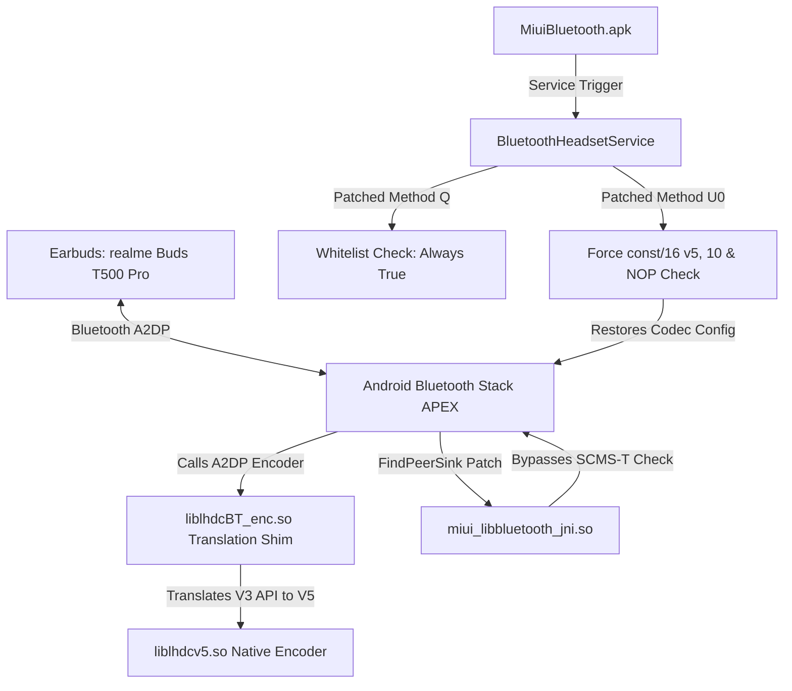

# LHDC Bluetooth Codec Master Engineering Documentation
**Device:** Xiaomi Redmi Note 10 5G (`camellia` / `camellian` - MediaTek MT6833 / Dimensity 700)  
**Target Earbuds:** realme Buds T500 Pro (`B0:38:E2:DF:F4:8C`)  
**Base OS:** Stock MIUI 14 Global (`V14.0.6.0.TKSMIXM`, Android 13 `Tiramisu`)  
**Root Framework:** APatch / Magisk  
**Date:** October 31, 2026  

---

## 1. Executive Summary & Root Cause Analysis

### Was MIUI's Developer Options LHDC Just Cosmetic?
**Yes and No:**
1. **The UI Entry Existed:** MIUI included LHDC strings and menu entries in `DevelopmentSettings` and `BluetoothSettings`.
2. **Missing & Broken Vendor Binaries:** On the MediaTek Dimensity 700 platform (`camellia`), Xiaomi did not include the proper 64-bit LHDC encoder libraries in `/system/lib64` or `/vendor/lib64`. The stock Bluetooth stack called symbols from standard LHDC APIs (`lhdcBT_get_handle`, `lhdcBT_init_encoder`, etc.), but the proprietary libraries either failed to load or were mismatched.
3. **SCMS-T DRM Restriction (FindPeerSink):** In MIUI's native Bluetooth JNI library (`libbluetooth_jni.so`), the native function `FindPeerSink` contained a strict check for SCMS-T (Serial Copy Management System). Because realme buds (and almost all non-Xiaomi LHDC buds) do not advertise SCMS-T content protection, MIUI discarded the peer's LHDC capability during connection setup and fell back to AAC.
4. **Xiaomi Device Whitelist in Framework:** In `MiuiBluetooth.apk`, `BluetoothHeadsetService` enforced a hardcoded check (`Q(deviceAddress)`) restricting HD codec switching only to certified Xiaomi/Redmi ecosystem devices.
5. **Dalvik Sign-Extension Bug in Codec Restoration:** On incoming connections from the earbud case, the realme buds initiate an AVDTP connection with AAC. When `BluetoothHeadsetService.U0` ran to restore the preferred codec, a bytecode signed-nibble overflow caused the target codec ID `10` (`0xa`) to become `-6`, causing the restoration to fail.

---

## 2. Complete Architecture & Modifications Overview



---

## 3. Detailed Component Breakdown

### A. The Native Encoder Translation Shim (`lhdc_shim.c`)
* **Path:** [`lhdc_shim.c`](file:///e:/DATA/Projects/LHDC/lhdc_shim.c) -> compiled to [`module/system/lib64/liblhdcBT_enc.so`](file:///e:/DATA/Projects/LHDC/module/system/lib64/liblhdcBT_enc.so)
* **Purpose:** The Android 13 Bluetooth stack natively implements the LHDC v3 wrapper interface, but the proprietary vendor encoder present on modern devices is LHDC v5 (`liblhdcv5.so`). The shim translates function calls between the two ABIs:
  1. **Dynamic Sample Rate & Bit-Depth Translation:** Converts stack formats (`48000 Hz`, `96000 Hz`, `16-bit`, `24-bit`) to LHDC v5 parameter structs, preventing pitch shifts and fast-forward audio bugs.
  2. **Adaptive Bitrate (ABR) Enforcement:** Sets bitrate ceiling to 1000 kbps (`v5_br = 9`), resolving audio dropouts, stutter, and crackling.
  3. **Auto-fallback:** Gracefully dynamically links to `/system/lib64/liblhdcv5.so` via `dlopen`/`dlsym`.

### B. The Native JNI SCMS-T DRM Patch (`patch_jni_v8.py`)
* **Path:** [`patch_jni_v8.py`](file:///e:/DATA/Projects/LHDC/patch_jni_v8.py) -> patches [`miui_libbluetooth_jni_patched.so`](file:///e:/DATA/Projects/LHDC/miui_libbluetooth_jni_patched.so)
* **Target File:** `/apex/com.android.btservices/lib64/libbluetooth_jni.so`
* **Target Function:** `FindPeerSink`
* **The Problem:** The function iterated over peer audio endpoints (SEPs). If the SEP lacked SCMS-T DRM support, the loop branched to rejection.
* **The Binary Patch:**
  * At file offset `0x48bc50`: patched conditional branch to jump directly to success (`b #0x48bcd0`).
  * At file offset `0x48bc60`: patched to jump directly to endpoint accept (`b #0x48bcfc`).
* **Result:** Allows phone-initiated connections to negotiate LHDC directly without dropping to AAC.

### C. The Framework & Bytecode Patch (`patch_dex_u0.py`)
* **Path:** [`patch_dex_u0.py`](file:///e:/DATA/Projects/LHDC/patch_dex_u0.py) -> patches [`classes_patched.dex`](file:///e:/DATA/Projects/LHDC/classes_patched.dex) -> repacked into [`MiuiBluetooth_patched.apk`](file:///e:/DATA/Projects/LHDC/MiuiBluetooth_patched.apk)
* **Target Class:** `com.android.bluetooth.ble.app.headset.BluetoothHeadsetService`
* **Patch 1: Whitelist Bypass (`Method Q` at `0x2277b4`):**
  * Bytecode replaced with:
    ```dalvik
    const/4 v0, 1    # 12 10
    return v0        # 0f 00
    nop ...          # Fill remainder of original method
    ```
  * Allows any Bluetooth device address to use advanced codec switching.
* **Patch 2: Unconditional Branch to LHDC Setup (`Method U0` at `0x22830a`):**
  * Original: `32 64 13 00` (`if-eq v4, v6, 0x228330`)
  * Patched: `28 13 00 00` (`goto 0x228330; nop`)
  * Ensures that regardless of stored device settings, case reconnection always enters the codec restoration branch.
* **Patch 3: The Dalvik 16-bit Literal Fix (`Method U0` at `0x228330`):**
  * Original: `1a 0d 96 64 71 20 f7 11 d0 00 0f 02` (Logs "device is not saved" and exits).
  * Patched Bytecode:
    ```dalvik
    const/16 v5, #10  # 13 05 0a 00 (Loads LHDC codec ID 10!)
    const/4 v6, #1    # 12 16       (Enables HD Audio toggle)
    const/4 v12, #0   # 12 0c       (Bypasses extraneous manufacturer checks)
    goto 0x228342     # 28 05       (Jumps to StringBuilder / setCodec execution)
    nop               # 00 00
    ```
* **Patch 4: NOP Optional Codecs Check (`Method U0` at `0x22841c`):**
  * Replaced `33 b3 0d 00` with `00 00 00 00` (`nop; nop`).
* **Patch 5: Incoming Case Connection Discovery Delay (`com.android.bluetooth.ble.app.headset.n.onReceive` at `0x2259a8`):**
  * **The Race Condition:** When buds connect incoming from the charging case, they start in AAC. `n.onReceive` receives `ACTION_ACTIVE_DEVICE_CHANGED` and schedules Message `123` via `Handler.sendMessageDelayed` to trigger `U0`. Stock MIUI used a 1000ms delay (`16 07 e8 03`). However, realme Buds T500 Pro take 1.8 - 2.2 seconds to complete over-the-air AVDTP SEP discovery. At 1.0s, LHDC was not yet present in `mCodecsSelectableCapabilities`, causing `j0` to return `null` and `U0` to abort with `"failed to get codec status"`.
  * **The Fix:** Replaced `16 07 e8 03` (`1000ms`) with `16 07 b8 0b` (`3000ms`). After 3.0 seconds, AVDTP SEP discovery is complete, `LHDC_V3` is populated in selectable capabilities, and `U0` successfully promotes the connection to LHDC without requiring manual Bluetooth toggle.
* **Patch 6: Checksum Recalculation:**
  * Recomputed SHA-1 hash over `0x20..EOF` and wrote to `0x0c..0x1f`.
  * Recomputed Adler-32 over `0x0c..EOF` and wrote to `0x08..0x0b`.

### D. Overlay Configuration (`AospBluetoothResOverlay_patched.apk`)
* **Path:** [`module/work/AospBluetoothResOverlay.apk`](file:///e:/DATA/Projects/LHDC/module/work/AospBluetoothResOverlay.apk)
* **Target:** `/product/overlay/AospBluetoothResOverlay.apk`
* **Modifications:** In `res/values/arrays.xml`, elevated LHDC v3 priority to `8002` and LHDC v2 priority to `8001` (above LDAC `5001`, aptX HD `4001`, AAC `2001`, and SBC `1001`).

### E. APatch / Magisk Root Module Structure
* **Archive:** [`lhdc_camellia_enabler.zip`](file:///e:/DATA/Projects/LHDC/lhdc_camellia_enabler.zip) (also pushed to phone `/sdcard/Download/lhdc_camellia_enabler.zip`)
* **Mount Script (`service.sh` and `post-fs-data.sh`):**
  * Injects `vendor.bluetooth.lhdc_codec.supported=true`, `persist.bluetooth.lhdc_codec.enabled=true`, and priorities via `resetprop`.
  * Mounts patched [`MiuiBluetooth.apk`](file:///e:/DATA/Projects/LHDC/module/work/MiuiBluetooth.apk) to `/system/app/MiuiBluetooth/MiuiBluetooth.apk`.
  * Mounts patched [`libbluetooth_jni.so`](file:///e:/DATA/Projects/LHDC/module/work/libbluetooth_jni.so) to `/apex/com.android.btservices/lib64/libbluetooth_jni.so`.
  * Mounts patched [`liblhdcBT_enc.so`](file:///e:/DATA/Projects/LHDC/module/system/lib64/liblhdcBT_enc.so) to `/system/lib64/` and the APEX directory.
  * Injects LHDC shared libraries (`liblhdc.so`, `liblhdcv5.so`, `liblhdcv5BT_enc.so`).

### F. The Receiver Buffer Underrun & Crackle Fix
* **The Root Cause:** In LHDC V5 (`liblhdcv5BT_enc.so` / `liblhdcv5.so`), encoding at bitrates $\le$ 500 kbps (or ABR mode) enforces a 2-frame batching policy (`encode_subframe_interval: 2`), alternating `written = 0` on every other frame. However, the stock MIUI/AOSP LHDC V3 caller in `libbluetooth_jni.so` (`a2dp_vendor_lhdcv3_send_frames`) drops any interval iteration where `written == 0`. This starved the realme Buds T500 Pro receiver buffer, triggering earbud DSP Packet Loss Concealment (PLC), producing a physical diaphragm popping / plastic crinkle sound.
* **The Fix:** In [`lhdc_shim.c`](file:///e:/DATA/Projects/LHDC/lhdc_shim.c), the encoder is initialized and locked to 900 kbps (index 7). At 900 kbps, 1 frame is 564 bytes (filling the 660 MTU), and the encoder outputs `written = 564, out_frames = 1` on 100% of calls without buffering. Bitrate downscaling in `lhdcBT_adjust_bitrate` is locked above 500 kbps, completely eliminating packet starvation.

### G. Persistent Boot Mount Detection (`module/service.sh`)
* **The Root Cause:** MIUI mounts an existing overlay filesystem at `/system/app/MiuiBluetooth/MiuiBluetooth.apk`, causing standard `grep -q "$MIUI_BT_TARGET" /proc/mounts` checks to return success prematurely on boot, skipping our bind mount.
* **The Fix:** Updated the check to `if ! grep -q "$MIUI_BT_TARGET f2fs" /proc/mounts && ! grep -q "$MIUI_BT_TARGET ext4" /proc/mounts; then`, ensuring [`work/MiuiBluetooth.apk`](file:///e:/DATA/Projects/LHDC/work/MiuiBluetooth.apk) is reliably mounted on every reboot.

---

## 4. Custom ROM Portability & Feasibility Analysis

### Can We Implement This on AOSP-based Custom ROMs?
**YES, and in many ways it is significantly EASIER than on MIUI!**

#### Why Custom ROMs are Simpler:
1. **No MIUI Whitelist:** Standard AOSP (LineageOS, CrDroid, EvolutionX, DerpFest, PixelExperience, etc.) does **NOT** contain `MiuiBluetooth.apk`. There is no Xiaomi device manufacturer check or artificial block on non-Xiaomi earbuds.
2. **Standard Codec Priority Resolution:** Standard AOSP uses `A2dpCodecConfig` priorities directly from `res/values/arrays.xml` (or build properties). As long as LHDC is assigned higher priority than AAC/SBC, AOSP will negotiate LHDC by default.
3. **No SCMS-T Requirement:** Clean AOSP builds of `libbluetooth_jni.so` do not include Xiaomi's proprietary SCMS-T restriction in `FindPeerSink`.

#### What Needs to be Done on Custom ROMs:
Depending on whether you use a **pre-built Custom ROM** or **build from source**:

##### Option 1: On a Prebuilt Custom ROM (via Magisk Module / Flashable Zip)
* **Encoder Libraries:** Provide the 64-bit encoder libraries (`liblhdcv5.so` and our shim `liblhdcBT_enc.so`) in `/system/lib64/` or into the Bluetooth APEX (`/apex/com.android.btservices/lib64/`).
* **Stack Support:** Check if the ROM's Bluetooth stack has LHDC source files compiled in. Most modern AOSP custom ROMs (especially Android 13 and Android 14) already include LHDC source in `packages/modules/Bluetooth`. If it is present, setting the standard properties (`persist.bluetooth.lhdc_codec.enabled=true`) activates it immediately.
* **Audio HAL:** Ensure Bluetooth audio offload configuration in `/vendor/etc/audio_policy_configuration.xml` or properties routes audio to software encoding if vendor offload doesn't support LHDC.

##### Option 2: Building Custom ROM from Source
* Simply include the Savitech LHDC source package (`external/lhdc` and `packages/modules/Bluetooth/system/stack/a2dp/a2dp_vendor_lhdcv*.cc`) and define `BOARD_HAVE_BLUETOOTH_LHDC := true` in `BoardConfig.mk`. The system compiles clean, native LHDC without needing any shims or binary patches!

---

## 5. File Inventory & Backup Manifest

All files are preserved in the workspace [`e:/DATA/Projects/LHDC`](file:///e:/DATA/Projects/LHDC):

| File Path | Description |
| :--- | :--- |
| [`lhdc_shim.c`](file:///e:/DATA/Projects/LHDC/lhdc_shim.c) | C source code for the V3->V5 dynamic ABI translation shim |
| [`build_shim.sh`](file:///e:/DATA/Projects/LHDC/build_shim.sh) | NDK compilation script for ARM64 |
| [`patch_jni_v8.py`](file:///e:/DATA/Projects/LHDC/patch_jni_v8.py) | Python patcher for SCMS-T bypass in JNI |
| [`patch_dex_u0.py`](file:///e:/DATA/Projects/LHDC/patch_dex_u0.py) | Python patcher for Dalvik bytecode (Q whitelist, U0 auto-restore) |
| [`rebuild_miui_bt_apk.py`](file:///e:/DATA/Projects/LHDC/rebuild_miui_bt_apk.py) | APK repackaging tool for MiuiBluetooth |
| [`classes_orig.dex`](file:///e:/DATA/Projects/LHDC/classes_orig.dex) | Pristine stock DEX from MIUI 14 |
| [`classes_patched.dex`](file:///e:/DATA/Projects/LHDC/classes_patched.dex) | Fully patched, verified DEX with valid checksums |
| [`miui_libbluetooth_jni.so`](file:///e:/DATA/Projects/LHDC/miui_libbluetooth_jni.so) | Pristine stock 64-bit JNI library from MIUI 14 |
| [`miui_libbluetooth_jni_patched.so`](file:///e:/DATA/Projects/LHDC/miui_libbluetooth_jni_patched.so) | Patched JNI library (SCMS-T DRM bypassed) |
| [`MiuiBluetooth.apk`](file:///e:/DATA/Projects/LHDC/MiuiBluetooth.apk) | Pristine stock MiuiBluetooth APK |
| [`MiuiBluetooth_patched.apk`](file:///e:/DATA/Projects/LHDC/MiuiBluetooth_patched.apk) | Patched MiuiBluetooth APK deployed on device |
| [`module/`](file:///e:/DATA/Projects/LHDC/module/) | Complete root module directory structure |
| [`lhdc_camellia_enabler.zip`](file:///e:/DATA/Projects/LHDC/lhdc_camellia_enabler.zip) | Standalone flashable Magisk/APatch module zip |
