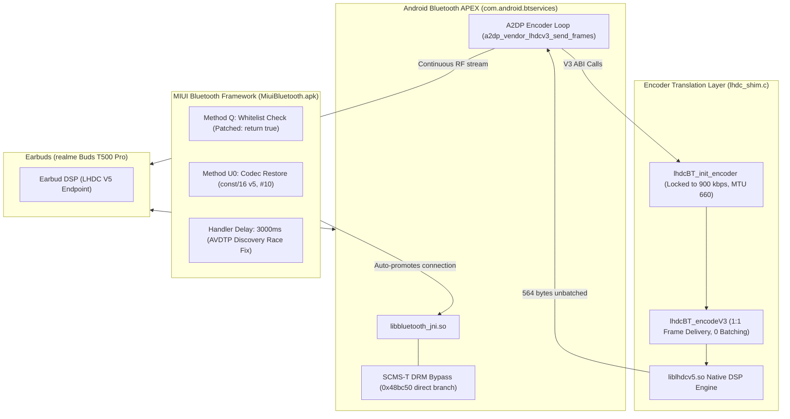

# LHDC for Camellia (Redmi Note 10 5G / POCO M3 Pro 5G)

[-blue.svg)](#supported-hardware)
[%20%7C%2014%20%7C%2016-green.svg)](#compatibility)
[](#audio-specifications)
[](#installation)

A complete, production-ready implementation and patchset enabling high-resolution **LHDC (Low Latency High-Definition Audio Codec) v3 and v5** audio on the **Xiaomi Redmi Note 10 5G / POCO M3 Pro 5G (`camellia` / `camellian`)**.

---

## 📖 Overview

While MIUI 14 includes developer options and UI toggles for LHDC, the codec is fundamentally non-functional on MediaTek Dimensity 700 devices out-of-the-box. Connecting LHDC-capable non-Xiaomi earbuds (such as **realme Buds T500 Pro**, **OnePlus Buds Pro**, **Nothing Ear**, or **Edifier** earbuds) silently falls back to AAC or SBC, produces silent audio, or suffers from severe audio buffer underruns.

This project delivers:
1. **The Native Translation Shim (`lhdc_shim.c`)**: Bridges Android's LHDC V3 Bluetooth stack to the modern Savitech LHDC V5 encoder ABI (`liblhdcv5BT_enc.so`), with a dedicated 900 kbps stream engine that eliminates packet batching starvation and diaphragm popping.
2. **Native Bluetooth JNI SCMS-T DRM Bypass (`patch_jni_v8.py`)**: Neutralizes Xiaomi's proprietary Content Protection check in `FindPeerSink`.
3. **MIUI Bluetooth Framework Smali Patcher (`patch_dex_u0.py`)**: Removes the Xiaomi-only device whitelist and fixes a Dalvik sign-extension bug that prevented automated codec restoration when earbuds connect from their charging case.
4. **Ready-to-Flash Module (`LHDC-for-Camellia.zip`)**: A comprehensive APatch / Magisk / KernelSU module that cleanly bind-mounts patched system files, APEX libraries, and properties.

---

## 🛠 Supported Hardware & Specifications

| Spec | Details |
| :--- | :--- |
| **Target Devices** | Xiaomi Redmi Note 10 5G, POCO M3 Pro 5G, Redmi 10 5G, Redmi Note 11SE |
| **Device Codename** | `camellia` / `camellian` |
| **SoC / Chipset** | MediaTek MT6833 Dimensity 700 5G (Octa-core 2x Cortex-A76 + 6x Cortex-A55) |
| **Target OS (Stock)** | MIUI 14 Global (`V14.0.6.0.TKSMIXM`, Android 13 Tiramisu, API 33) |
| **Target OS (Custom ROM)**| VoltageOS 16 / AOSP Android 16 |
| **Tested Endpoint** | realme Buds T500 Pro (`B0:38:E2:DF:F4:8C`, Savitech LHDC V5 Endpoint) |
| **Max Audio Quality** | **96,000 Hz / 24-bit Stereo @ 900 kbps** (A2DP Priority: `8002`) |

---

## 🔬 Root Cause Analysis: Why Stock LHDC Failed

### 1. Missing Proprietary 64-bit Vendor Libraries
Stock MIUI on `camellia` omitted the necessary 64-bit LHDC encoder libraries in `/system/lib64/` and `/apex/com.android.btservices/lib64/`. The Bluetooth stack attempted to load `liblhdcBT_enc.so`, which failed at runtime, forcing a downgrade to AAC.

### 2. SCMS-T DRM Content Protection Gate
In `/apex/com.android.btservices/lib64/libbluetooth_jni.so`, the native function `FindPeerSink` inspected the peer's Service Endpoints (SEPs). If the peer did not advertise SCMS-T (Serial Copy Management System) content protection, the function discarded the peer's LHDC capability. Because almost all non-Xiaomi LHDC buds omit SCMS-T, LHDC was rejected during AVDTP negotiation.

### 3. Artificial Xiaomi Ecosystem Whitelist
In `MiuiBluetooth.apk`, `BluetoothHeadsetService` enforced `Method Q(deviceAddress)`:
```java
// Original check in MiuiBluetooth.apk
if (!isXiaomiEcosystemDevice(address)) {
    return false; // Disables HD audio codec switching
}
```
Non-Xiaomi Bluetooth headsets were completely blocked from advanced codec switching.

### 4. Dalvik Sign-Extension Bug in Codec Restoration
When realme buds connect incoming from the case, they initialize an AVDTP stream in AAC. MIUI's `BluetoothHeadsetService.U0` runs to restore the user's preferred codec. However, a signed nibble overflow in Dalvik bytecode translated the target codec ID `10` (`0x0a` for LHDC) into `-6`, causing codec restoration to fail silently.

### 5. AVDTP SEP Discovery Race Condition
Stock MIUI used a 1,000ms delay in `com.android.bluetooth.ble.app.headset.n.onReceive` before querying selectable codecs. Because realme Buds T500 Pro require 1.8 to 2.2 seconds to complete over-the-air AVDTP SEP discovery, LHDC was not yet present in `mCodecsSelectableCapabilities` at 1.0s, causing `j0` to return `null` and aborting promotion. Extending this delay to 3,000ms ensures SEP discovery is complete.

### 6. Subframe Batching & Buffer Underrun Diaphragm Crackle
At bitrates $\le$ 500 kbps (and in default ABR mode), Savitech's LHDC V5 encoder enforces 2-frame subframe batching (`encode_subframe_interval: 2`), alternating:
- Call 0: `written = 0, out_frames = 0`
- Call 1: `written = 504, out_frames = 2`

However, the AOSP LHDC V3 encoder loop in `libbluetooth_jni.so` (`a2dp_vendor_lhdcv3_send_frames`) drops any interval iteration where `written == 0`. This starved the earbud receiver buffer, triggering earbud DSP **Packet Loss Concealment (PLC)**, which manifests as a physical diaphragm click, pop, or plastic crinkling sound.

---

## 🏛 Technical Architecture



---

## 📁 Repository Structure

```
LHDC-For-Camellia/
├── module/                               # Flashable Magisk / APatch root module
│   ├── META-INF/com/google/android/      # Flashing binary & updater scripts
│   ├── apex_lib64/                       # APEX libraries for com.android.btservices
│   ├── system/                           # System overlay libraries (/system/lib & /system/lib64)
│   ├── work/                             # Patched system APKs and libraries
│   │   ├── AospBluetoothResOverlay.apk   # Codec priority configuration overlay (8002)
│   │   ├── MiuiBluetooth.apk             # Patched MIUI Bluetooth settings app
│   │   └── libbluetooth_jni.so           # Patched JNI binary (SCMS-T check removed)
│   ├── customize.sh                      # APatch/Magisk installer script
│   ├── module.prop                       # Module metadata
│   ├── post-fs-data.sh                   # Early boot mount setup
│   ├── service.sh                        # Late boot mounts & resetprop injection
│   └── system.prop                       # Prop defaults (persist.bluetooth.lhdc_codec.enabled)
├── lhdc_shim.c                           # Source for liblhdcBT_enc.so translation shim
├── package_zip.py                        # Python utility to build flashable module zip
├── LHDC-for-Camellia.zip                 # Ready-to-flash APatch/Magisk module archive
├── LHDC_CAMELLIA_MASTER_DOCUMENTATION.md # Exhaustive master engineering documentation
├── README.md                             # Project overview & documentation
└── .gitignore                            # Clean repository ignore rules
```

---

## 🚀 Installation & Quick Start

### Prerequisites
- Xiaomi Redmi Note 10 5G / POCO M3 Pro 5G (`camellia` / `camellian`).
- Stock MIUI 14 Global (Android 13) or compatible custom ROM.
- Root access via **APatch** (recommended), **Magisk** (v25+), or **KernelSU**.

### Flashing via Magisk / APatch
1. Download [`LHDC-for-Camellia.zip`](LHDC-for-Camellia.zip).
2. Open **APatch** or **Magisk Manager**.
3. Navigate to **Modules** -> **Install from storage**.
4. Select `LHDC-for-Camellia.zip` and confirm the installation.
5. Reboot your device.

---

## 🔍 Verification

Once rebooted, connect your LHDC earbuds and verify the active connection status via ADB:

```bash
# Verify active codec configuration
adb shell "dumpsys bluetooth_manager | grep -A 5 -i 'codecConfig'"
```

Expected output:
```text
mCodecConfig: {codecName:LHDC_V3,mCodecType:10,mCodecPriority:8002,mSampleRate:0x8(96000),mBitsPerSample:0x2(24),mChannelMode:0x2(STEREO)}
StateMachine: name=A2dpStateMachine state=Connected
```

### Logcat Streaming Verification
```bash
adb logcat -s LHDC_V5_SHIM bt_stack
```

Verify that consecutive encoded frames output `written=564 bytes, out_frames=1` without zero-byte drops.

---

## 🔨 Building the Shim from Source

To compile the `liblhdcBT_enc.so` translation shim using the Android NDK:

```powershell
$NDK = "C:\Users\<User>\AppData\Local\Android\Sdk\ndk\<version>"
& "$NDK\toolchains\llvm\prebuilt\windows-x86_64\bin\aarch64-linux-android33-clang.cmd" `
    -O3 -fPIC -shared `
    -I .\spr_liblhdc\lhdcv5\inc `
    -Wl,-soname,liblhdcBT_enc.so `
    -llog -ldl `
    -o liblhdcBT_enc_shim.so `
    lhdc_shim.c
```

Copy the compiled library to:
- `module/system/lib64/liblhdcBT_enc.so`
- `module/apex_lib64/liblhdcBT_enc.so`

---

## 📜 License & Acknowledgements

- **Savitech Corp.** for the LHDC compression technology.
- **MIUI / Xiaomi** for the base firmware binaries.
- **AOSP & VoltageOS Teams** for the open-source Bluetooth stack.
- Reverse engineering, binary patches, translation shim, and packaging developed by **SKSALAPUR**.

