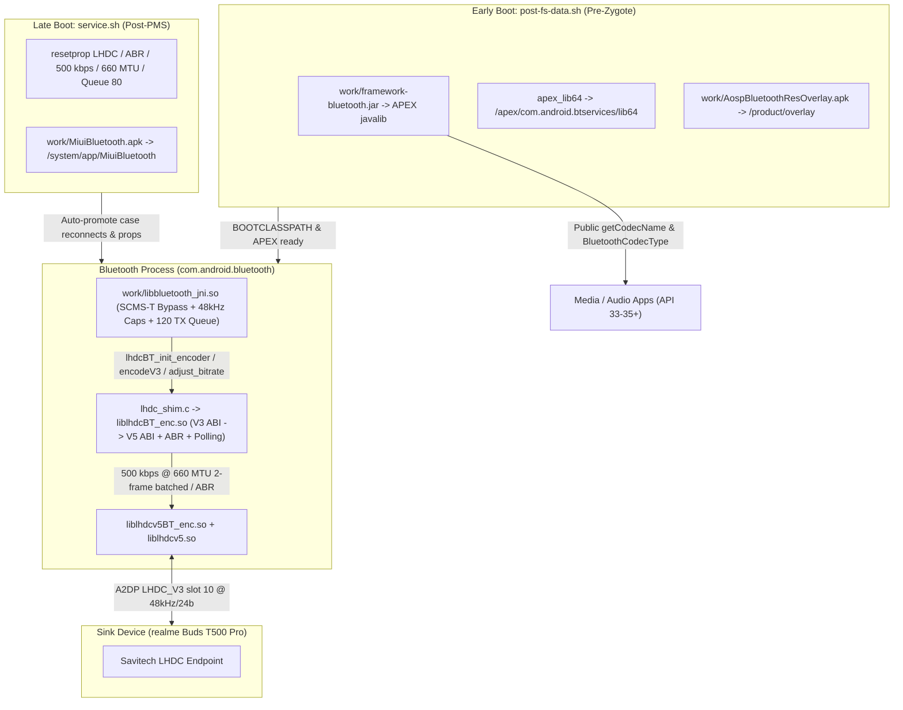

# LHDC for Camellia (Redmi Note 10 5G / POCO M3 Pro 5G)

[-blue.svg)](#supported-hardware--specifications)
[](#custom-rom-portability)
[](#audio-profile--tuning-rationale)
[](#installation--flashing)

A complete reverse-engineered binary patchset, V3-to-V5 native encoder shim, framework codec-name fix, and flashable root module that brings genuine, dropout-free **LHDC (Low Latency High-Definition Audio Codec)** support to **Xiaomi Redmi Note 10 5G / POCO M3 Pro 5G (`camellia` / `camellian`)**.

---

## Overview

Out of the box, MIUI 14 on `camellia` ships LHDC toggles in Developer Options and Bluetooth Settings, yet connecting LHDC-capable non-Xiaomi earbuds (such as **realme Buds T500 Pro**, **OnePlus Buds Pro**, **Nothing Ear**, or **Edifier**) fails silently into **AAC/SBC**, drops frames with receiver crackles, or reports `"Vendor Codec (10)"` to audio apps.

This repository resolves the full end-to-end stack cleanly without app hooking or codec spoofing:

1. **Native V3 -> V5 Encoder Translation Shim ([`lhdc_shim.c`](lhdc_shim.c))** — Compiles to `liblhdcBT_enc.so`, bridging Android 13's LHDC V3 Bluetooth stack ABI to the Savitech LHDC V5 DSP encoder (`liblhdcv5BT_enc.so` + `liblhdcv5.so`) with configurable bitrate/MTU, 2-frame packet batching at 500 kbps @ 660 MTU, congestion-aware ABR, and live property polling.
2. **Bluetooth JNI Patches (`module/work/libbluetooth_jni.so`)** — Bypasses Xiaomi's SCMS-T DRM gate in `FindPeerSink`, locks LHDC local capabilities cleanly to 48 kHz to prevent OTA clock/pitch drift, and expands Fluoride's A2DP TX queue buffer ceiling to `120` packets.
3. **MIUI Bluetooth Auto-Promotion Fix (`module/work/MiuiBluetooth.apk`)** — Removes Xiaomi's ecosystem MAC whitelist (`Method Q`), fixes a Dalvik signed-nibble bug (`Method U0` failing to restore vendor codec ID `10`), and widens the AVDTP SEP discovery timer from `1000 ms` to `3000 ms` so incoming case reconnects automatically promote from AAC to `LHDC_V3`.
4. **Codec Resource Priority Overlay (`module/work/AospBluetoothResOverlay.apk`)** — Elevates LHDC priorities (`8003` / `8002` / `8001`) above LDAC (`5001`), aptX HD (`4001`), AAC (`2001`), and SBC (`1001`).
5. **Android Framework Codec-Name & Extended Type Fix (`module/work/framework-bluetooth.jar`)** — Exposes true codec names (`"LHDC_V2"`, `"LHDC_V3"`, `"LHDC_V1"`, `"LHDC_V5"`) on vendor slots `9..12` via public `BluetoothCodecConfig.getCodecName()`, unblocked static `getCodecName(int)`, and backported `BluetoothCodecType` / `getExtendedCodecType()` APIs for Android 15+ (`targetSdk >= 35`) audio apps.
6. **Ready-to-Flash Root Module ([`LHDC-for-Camellia.zip`](LHDC-for-Camellia.zip))** — Tested on **APatch** (with Hybrid Mount) and compatible with **Magisk** / **KernelSU**.

---

## Supported Hardware & Specifications

| Parameter | Details |
| :--- | :--- |
| **Target Devices** | Xiaomi Redmi Note 10 5G, POCO M3 Pro 5G, Redmi 10 5G, Redmi Note 11SE (`camellia` / `camellian`) |
| **SoC** | MediaTek MT6833 (Dimensity 700 5G) |
| **Verified Stock OS** | MIUI 14 Global (`V14.0.6.0.TKSMIXM`, Android 13 / API 33) |
| **Tested Sink Device** | realme Buds T500 Pro (`B0:38:E2:DF:F4:8C`, Savitech LHDC endpoint) |
| **Negotiated A2DP Slot** | `10` (`LHDC_V3`, A2DP Priority `8002` / `1000000` when selected) |
| **Default Audio Format** | **48,000 Hz / 24-bit Stereo** |
| **Default Bitrate & MTU** | **500 kbps (`v5_br = 6`) @ 660 MTU** (2-frame batching + ABR enabled) |
| **Supported Bitrate Tiers** | `500` kbps (`v5_br=6`), `900` kbps (`v5_br=7`), `1000` kbps (`v5_br=8`) via runtime property |
| **Congestion Guard** | Threshold `80` queued TX packets (40-packet margin under Fluoride's `120` limit) |

---

## Audio Profile & Tuning Rationale

Why the module ships **48 kHz / 24-bit @ 500 kbps with 660 MTU + ABR** by default instead of hard-locking 96 kHz / 1000 kbps:

- **Packet Rate & Batching (`500 kbps @ 660 MTU`)**: At `48 kHz` with `block_size = 240` samples, each LHDC V5 frame represents `5 ms` of audio (`200` encoder calls/sec). At `500 kbps`, one `5 ms` frame is ~313 bytes, so with `MTU = 660`, two encoded frames (~626 bytes) fit inside a single A2DP L2CAP/RTP packet (`written = 0, out_frames = 0` on the first frame, emitting a 2-frame packet on the alternating frame). This halves the Bluetooth HCI transmission rate from **200 pkt/s to 100 pkt/s** while keeping `MTU >= 660` compatible with dynamic ABR/bitrate jumps up to `1000 kbps`. Lowering MTU to `600` cannot fit two `500 kbps` frames per packet and doubles the packet rate.
- **Buffer Headroom & ABR Step-Down**: Fluoride's A2DP TX queue limit in `libbluetooth_jni.so` is expanded to `120` packets (`persist.bluetooth.lhdc_max_queue=80`). When `ABR` is enabled and RF congestion pushes the TX queue above `80` for `5` consecutive frames (after a `2000`-frame ~10 s connection warmup), `lhdcBT_adjust_bitrate` steps down (`> 6 -> 6`, or emergency index `4` above `110`) and automatically recovers to the configured target after `300` consecutive clean frames (`queueLen <= 50`).
- **On-Demand High Bitrate (`900` / `1000` kbps)**: Setting `persist.bluetooth.lhdc_bitrate` to `900` (~563 B/frame) or `1000` (`626` B/frame observed in `LHDC_V5_SHIM`, guarded to `MTU >= 660` to avoid `lhdcv5BT_encode` `-10` silent frame drops) switches to single-frame (`out_frames = 1`) unbatched transmission whenever desired. Note that in 24-bit / 48 kHz studio playback, 500 kbps maintains wide margin with virtually identical perceptual transparency on TWS earbuds under mobile RF interference.

---

## Root Cause Analysis: Seven Problems Solved

### 1. Missing 64-bit Vendor Libraries & V3 -> V5 ABI Gap
Stock MIUI on `camellia` shipped no 64-bit LHDC encoder in `/system/lib64/` or `/apex/com.android.btservices/lib64/`, while Android 13's `libbluetooth_jni.so` expects LHDC V3 C entry points (`lhdcBT_get_handle`, `lhdcBT_init_encoder`, `lhdcBT_encodeV3`, `lhdcBT_adjust_bitrate`, etc.) rather than Savitech's V5 library (`liblhdcv5BT_enc.so` / `liblhdcv5.so`). [`lhdc_shim.c`](lhdc_shim.c) preloads `liblhdcv5.so` with `RTLD_GLOBAL`, resolves all V5 symbols via `dlopen`/`dlsym`, and translates V3 calls cleanly to V5.

### 2. SCMS-T Content Protection DRM Gate (`libbluetooth_jni.so`)
In Xiaomi's native `FindPeerSink`, peer SEPs that did not advertise **SCMS-T** content protection were discarded during AVDTP negotiation. Non-Xiaomi buds omit SCMS-T, causing phone-initiated connects to fall back to AAC. Branch patches in `module/work/libbluetooth_jni.so` accept valid peer SEPs without SCMS-T.

### 3. Xiaomi Ecosystem Whitelist (`MiuiBluetooth.apk`)
`com.android.bluetooth.ble.app.headset.BluetoothHeadsetService.Q(deviceAddress)` rejected non-Xiaomi Bluetooth MAC prefixes. Patching `Method Q` to return `true` unlocks HD codec UI toggles and switching for third-party earbuds.

### 4. Dalvik Sign-Extension Codec Restore Bug (`MiuiBluetooth.apk`)
On incoming reconnects from the charging case, earbuds initially bring up AAC while `BluetoothHeadsetService.U0` tries to restore the preferred codec. A signed-nibble overflow converted LHDC V3 codec ID `10` (`0x0a`) into `-6`. Replacing the literal with `const/16 v5, #10` (`13 05 0a 00`) restores slot `10` properly.

### 5. AVDTP SEP Discovery Race Condition (`MiuiBluetooth.apk`)
Stock MIUI delayed `U0` promotion by `1000 ms` inside `com.android.bluetooth.ble.app.headset.n.onReceive`, whereas earbuds such as realme Buds T500 Pro take ~1.8–2.2 s to populate `mCodecsSelectableCapabilities`. Increasing that handler delay to `3000 ms` ensures LHDC is selectable when auto-promotion runs.

### 6. Sample-Rate Drift & Fluoride Queue Overruns
Unconstrained capability tables allowed buggy 44.1/96 kHz transitions causing speed/pitch drift, and tight default A2DP queue limits caused audible buffer pops during RF contention. Locking local capabilities cleanly to 48 kHz in `libbluetooth_jni.so`, expanding Fluoride's queue to `120`, and tuning `lhdc_shim.c` batching/ABR resolved all popping and drift.

### 7. `"Vendor Codec (10)"` & Null Codec Name in Apps (`framework-bluetooth.jar`)
Even with genuine `LHDC_V3` encoding active, Android apps (especially `targetSdk >= 35` players such as BitChord / LastWave) displayed `"Vendor Codec (10)"` or empty codec labels because stock Android 13 `framework-bluetooth.jar`:
- lacked the instance `BluetoothCodecConfig.getCodecName()` (0-arg) method,
- marked static `BluetoothCodecConfig.getCodecName(int)` as `hiddenapi: 0x0002` (`BLOCKED`), and
- lacked `android.bluetooth.BluetoothCodecType` and `BluetoothCodecConfig.getExtendedCodecType()`.

This module ships a cleanly patched [`module/work/framework-bluetooth.jar`](module/work/framework-bluetooth.jar) (bind-mounted in [`module/post-fs-data.sh`](module/post-fs-data.sh) before `zygote` initializes `BOOTCLASSPATH`) that maps:
- Slot `9` -> `"LHDC_V2"` (`codecId = 0x4c32053affL`)
- Slot `10` -> `"LHDC_V3"` (`codecId = 0x4c33053affL`)
- Slot `11` -> `"LHDC_V1"` (`codecId = 0x4c31053affL`)
- Slot `12` -> `"LHDC_V5"` (`codecId = 0x4c35053affL`)
while preserving standard mappings (`SBC`, `AAC`, `aptX`, `aptX HD`, `LDAC`, `LC3`, `Opus`) without spoofing non-LHDC connections.

---

## Technical Architecture



---

## Boot Mount & Module Lifecycle

- **[`module/customize.sh`](module/customize.sh)**: Runs at flash time (`apd` / Magisk). Sets permissions (`0755`/`0644`), copies existing `/apex/com.android.btservices/lib64/*` symlinks and vendor encoders (`libaptX_encoder.so`, `libaptXHD_encoder.so`) into `$MODPATH/apex_lib64/`, and overlays our patched `liblhdcBT_enc.so`, `libbluetooth_jni.so`, `liblhdcv5BT_enc.so`, and `liblhdcv5.so`.
- **[`module/post-fs-data.sh`](module/post-fs-data.sh)**: Runs before `zygote` starts. Bind-mounts `AospBluetoothResOverlay.apk`, `$MODDIR/apex_lib64`, fallback `.so` mounts, and **`work/framework-bluetooth.jar`** (after applying `chmod 0644` and `chcon u:object_r:system_file:s0`) onto `/apex/com.android.btservices/javalib/framework-bluetooth.jar`.
  > **Why `MiuiBluetooth.apk` is NOT mounted here:** Mounting `MiuiBluetooth.apk` during `post-fs-data` causes Android's `PackageManagerService` to drop `com.xiaomi.bluetooth` on boot due to signature verification against `/system`. It is mounted late in `service.sh`.
- **[`module/service.sh`](module/service.sh)**: Waits for `sys.boot_completed=1`, injects properties via `resetprop` (APatch/Magisk), verifies all overlay/APEX/shim mounts plus `/system/app/MiuiBluetooth/MiuiBluetooth.apk` (checking explicit `f2fs`/`ext4` mount status), and restarts `com.xiaomi.bluetooth` / `com.android.bluetooth` if any mount was applied late.

---

## Runtime Configuration & System Properties

All properties are configured in [`module/system.prop`](module/system.prop) and reinforced in [`module/service.sh`](module/service.sh):

| Property | Default | Valid Values / Notes |
| :--- | :---: | :--- |
| `persist.bluetooth.lhdc_bitrate` | `500` | `500` (`v5_br=6`), `900` (`v5_br=7`), `1000` (`v5_br=8`). Polled live every 20 clean frames (`<= 50` TX queue) after initial `2000`-frame warmup; updates both `max_bitrate` and active bitrate. |
| `persist.bluetooth.lhdc_mtu` | `660` | `300..1000` (read in `lhdcBT_init_encoder` on BT connect/init). Auto-clamped to `>= 660` if target bitrate is `1000` kbps to prevent `-10` overflow drops. |
| `persist.bluetooth.lhdc_max_queue` | `80` | `20..100`. Fluoride queue congestion threshold before ABR steps down bitrate (`40`-packet safety cushion below Fluoride's `120` limit). |
| `persist.vendor.bluetooth.lhdc_abr` | `true` | `true` / `false` (`1` / `0`). Enables congestion downscaling (`> lhdc_max_queue` for 5 frames; emergency index `4` if `> 110`) and recovery (`300` clean frames `<= 50`). |
| `vendor.bluetooth.lhdc.abr` | `true` | `true` / `false`. Fallback ABR property checked by shim. |
| `vendor.bluetooth.lhdc_codec.supported` | `true` | Enables MIUI/AOSP LHDC hardware capability flag. |
| `persist.bluetooth.lhdc_codec.enabled` | `true` | Enables LHDC source selection. |
| `persist.bluetooth.a2dp.lhdc.whitelist` | `false` | Disables vendor whitelist filtering. |
| `bluetooth.a2dp.source.lhdcv5_priority.config` | `8003` | A2DP codec priority for LHDC V5. |
| `bluetooth.a2dp.source.lhdcv3_priority.config` | `8002` | A2DP codec priority for LHDC V3 (active slot `10`). |
| `bluetooth.a2dp.source.lhdcv2_priority.config` | `8001` | A2DP codec priority for LHDC V2 (slot `9`). |
| `persist.bluetooth.a2dp_offload.disabled` | `false` | Keeps standard A2DP offload path state intact. |

### Changing Bitrate at Runtime (Without Rebooting)
Because `lhdcBT_adjust_bitrate` polls `persist.bluetooth.lhdc_bitrate` and raises `set_max_bitrate` automatically, you can test another tier live (after ~10 s warmup):
```bash
adb shell "su -c '/data/adb/ap/bin/resetprop persist.bluetooth.lhdc_bitrate 900'"
# To revert to batched 500 kbps default:
adb shell "su -c '/data/adb/ap/bin/resetprop persist.bluetooth.lhdc_bitrate 500'"
```
*(Changing `persist.bluetooth.lhdc_mtu` takes effect on the next A2DP stream initialization / Bluetooth toggle; make edits persistent by updating `module/system.prop` and `module/service.sh`.)*

---

## Repository Structure

```text
LHDC/
├── lhdc_shim.c                             # C translation shim (LHDC V3 ABI -> V5 DSP + ABR + polling)
├── package_zip.py                          # Packs module/ into LHDC-for-Camellia.zip with UNIX paths
├── LHDC-for-Camellia.zip                   # Ready-to-flash APatch / Magisk / KernelSU archive
├── LHDC_CAMELLIA_MASTER_DOCUMENTATION.md   # Deep binary patch offset & Dalvik bytecode reference
├── README.md                               # Architecture, build, tuning, and verification guide
├── .gitignore                              # Ignores local scratch builds/artifacts while keeping module zip
└── module/
    ├── META-INF/com/google/android/
    │   ├── update-binary                   # Module installer entrypoint
    │   └── updater-script
    ├── apex_lib64/                         # 64-bit libs overlaid onto /apex/com.android.btservices/lib64
    │   ├── liblhdc.so
    │   ├── liblhdcBT_enc.so                # Compiled lhdc_shim.c
    │   ├── liblhdcv5.so                    # Savitech V5 DSP engine
    │   └── liblhdcv5BT_enc.so              # Savitech V5 encoder wrapper
    ├── system/
    │   ├── lib/                            # 32-bit vendor fallback libraries
    │   └── lib64/                          # 64-bit vendor fallback libraries (/system/lib64)
    ├── work/
    │   ├── AospBluetoothResOverlay.apk     # Sets LHDC priority 8002 / 8001 in frameworks overlay
    │   ├── MiuiBluetooth.apk               # Whitelist + U0 codec ID 10 + 3000ms SEP delay patches
    │   ├── framework-bluetooth.jar         # Public getCodecName() & BluetoothCodecType for slots 9-12
    │   └── libbluetooth_jni.so             # SCMS-T bypass + 48 kHz caps + 120-pkt TX queue
    ├── customize.sh                        # Flash-time APEX layout builder & permissions
    ├── module.prop                         # Module ID (lhdc_codec_old), version, description
    ├── post-fs-data.sh                     # Early pre-zygote mounts (framework jar, APEX lib64, overlay)
    ├── service.sh                          # Late boot resetprop & MiuiBluetooth.apk bind mount
    └── system.prop                         # Default LHDC/ABR/MTU properties
```

---

## Installation & Flashing

### Option A: APatch / Magisk Manager App (GUI)
1. Download [`LHDC-for-Camellia.zip`](LHDC-for-Camellia.zip) to `/sdcard/Download/`.
2. Open **APatch Manager** (recommended, tested with Hybrid Mount) or **Magisk Manager** / **KernelSU**.
3. Go to **Modules** -> **Install from storage** -> select `LHDC-for-Camellia.zip`.
4. Reboot the device.

### Option B: APatch CLI via ADB
```bash
adb push LHDC-for-Camellia.zip /sdcard/Download/LHDC-for-Camellia.zip
adb shell "su -c '/data/adb/ap/bin/apd module install /sdcard/Download/LHDC-for-Camellia.zip'"
adb reboot
```

---

## Building the Shim & Repackaging from Source

1. Compile [`lhdc_shim.c`](lhdc_shim.c) with Android NDK (`r27`, API 33 `aarch64` clang):

```powershell
$NDK = "C:\Users\<User>\AppData\Local\Android\Sdk\ndk\27.0.12077973"
& "$NDK\toolchains\llvm\prebuilt\windows-x86_64\bin\aarch64-linux-android33-clang.cmd" `
    -O3 -fPIC -shared -llog -ldl `
    -o liblhdcBT_enc.so `
    lhdc_shim.c

Copy-Item -Force liblhdcBT_enc.so module\system\lib64\liblhdcBT_enc.so
Copy-Item -Force liblhdcBT_enc.so module\apex_lib64\liblhdcBT_enc.so
```

2. Ensure shell/prop scripts use LF (`\n`, no CRLF) and package the zip with [`package_zip.py`](package_zip.py):

```powershell
python package_zip.py
```

This writes `LHDC-for-Camellia.zip` at the repository root.

---

## Verification Checklist

Connect your LHDC headphones and play audio, then run:

### 1. Active A2DP Codec, Sample Rate, & Bitrate
```bash
adb shell "su -c 'dumpsys bluetooth_manager | grep -E \"Current Codec:|mCodecConfig:|Config: Rate=|LHDC quality mode|LHDC transmission bitrate|PCM read counts\"'"
```
Expected active output:
```text
mCodecConfig: {codecName:LHDC_V3,mCodecType:10,mCodecPriority:1000000,mSampleRate:0x2(48000),mBitsPerSample:0x2(24),mChannelMode:0x2(STEREO),...}
Current Codec: LHDC_V3
Config: Rate=48000 Bits=24 Mode=STEREO
LHDC quality mode                                       : ABR
LHDC transmission bitrate (Kbps)                        : 500
```
*(Verify that `PCM read counts (expected/actual)` increments under `A2DP LHDC_V3 State`, confirming genuine LHDC encoding rather than SBC/AAC fallback.)*

### 2. Shim Initialization & Live Encoding Logcat
```bash
adb logcat -d -s LHDC_V5_SHIM | tail -n 25
```
Expected initialization & runtime frames:
```text
I LHDC_V5_SHIM: lhdcv5BT_init_encoder returned 0 (v5_br=6, mtu=660, interval=20)
I LHDC_V5_SHIM: init_encoder config: block_size=240, bytes_per_frame=1440
I LHDC_V5_SHIM: lhdcBT_set_bitrate: set V5 target index 6 -> ret=0
```

### 3. Framework Codec Name Mount Verification
Confirm `com.android.bluetooth` and `system_server` loaded the patched `framework-bluetooth.jar` with `system_file` SELinux context:
```bash
adb shell "su -c 'ls -laZ /apex/com.android.btservices/javalib/framework-bluetooth.jar; grep framework-bluetooth /proc/\$(pidof com.android.bluetooth)/maps | head -n 3'"
```
Apps inspecting `BluetoothCodecConfig.getCodecName()`, `BluetoothCodecConfig.getCodecName(int)`, and `BluetoothCodecConfig.getExtendedCodecType().getCodecName()` will receive `"LHDC_V3"` on codec slot `10` (instead of `"Vendor Codec (10)"` or `null`).

---

## Custom ROM Notes

Standard AOSP custom ROMs (LineageOS, CrDroid, EvolutionX, etc.) do **not** contain `MiuiBluetooth.apk` or Xiaomi's SCMS-T gate in `libbluetooth_jni.so`. See Section 4 of [`LHDC_CAMELLIA_MASTER_DOCUMENTATION.md`](LHDC_CAMELLIA_MASTER_DOCUMENTATION.md) for adapting just the encoder libraries (`liblhdcBT_enc.so`, `liblhdcv5.so`, `liblhdcv5BT_enc.so`) and AOSP stack properties on non-MIUI builds.

---

## Acknowledgements

- **Savitech Corp.** for LHDC compression technology.
- **Xiaomi / MIUI** for the base firmware libraries.
- **AOSP, VoltageOS, APatch & Hybrid Mount** communities.
- Reverse engineering, binary patches, translation shim, framework fix, and packaging by **SKSALAPUR**.
